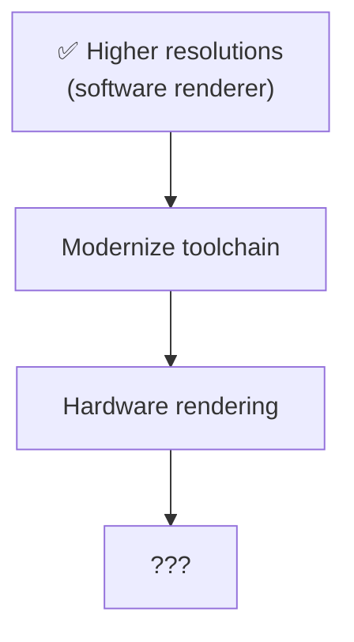
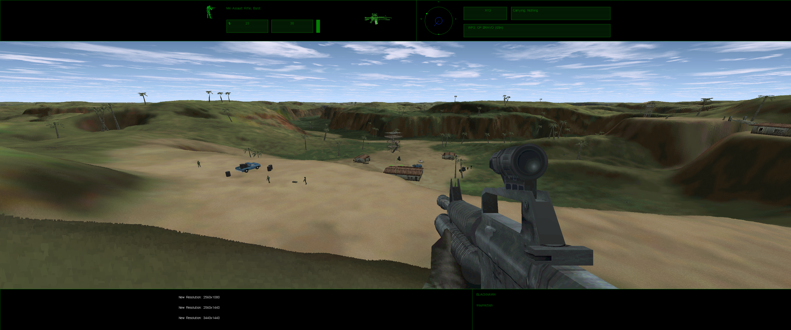
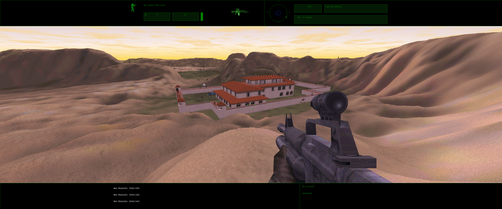
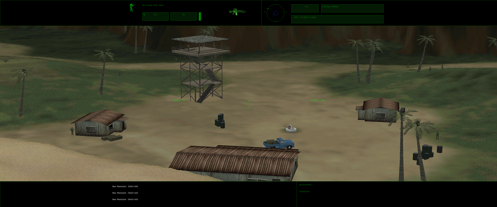
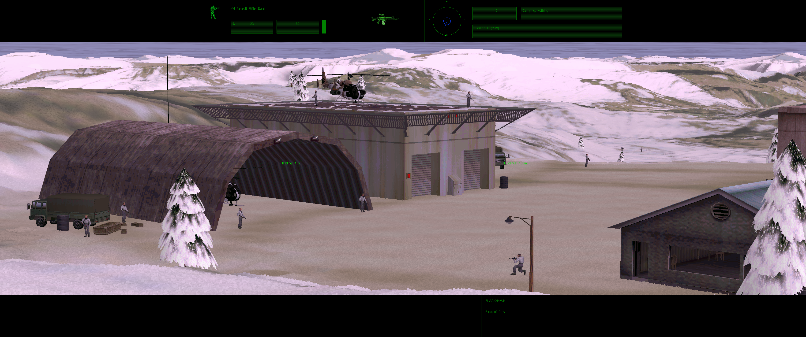
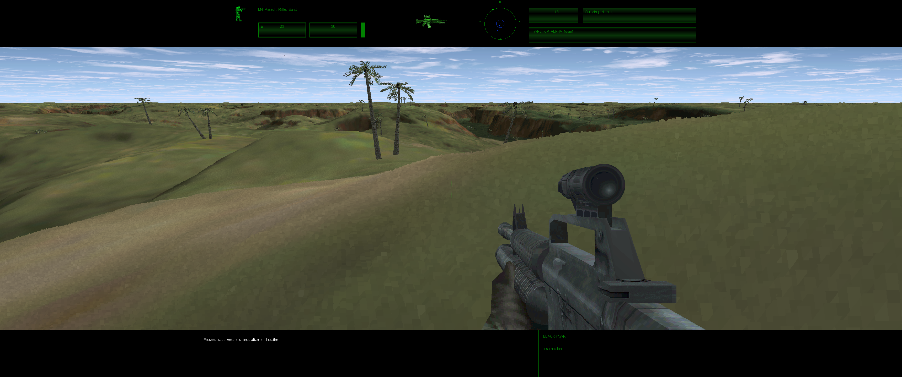
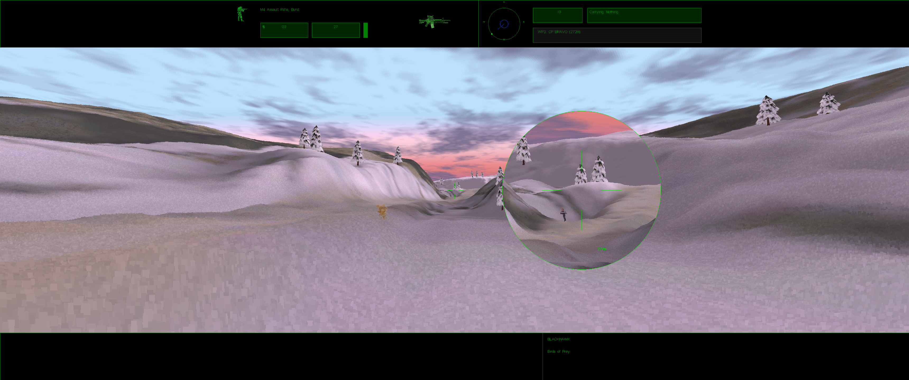
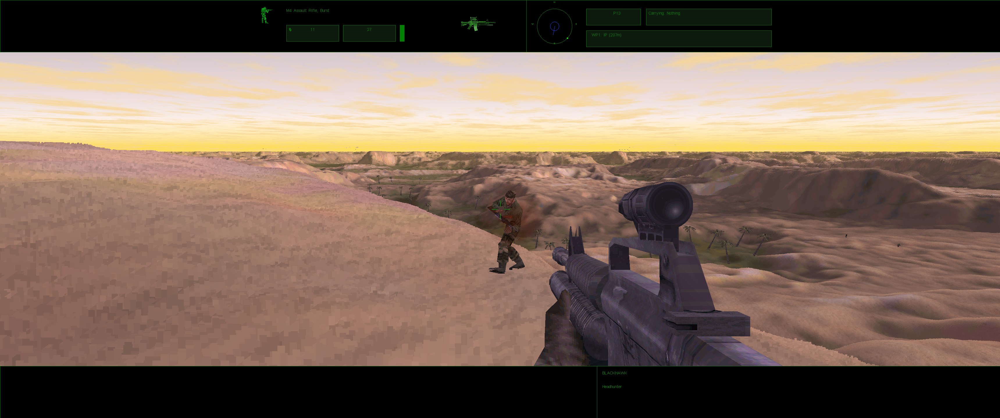

# Delta Force 1 (1998) HD

A patched executable (`dfhd.exe`) for Delta Force v1.00.03.03P that runs at higher resolutions, up to your desktop resolution, without extra tools like dgVoodoo2.

Download `dfhd.zip` from the [releases page](https://github.com/phpfivesix/dfhd/releases).

See [readme.txt](readme.txt) for installation, changes and commands.

## Troubleshooting

Remove any wrappers or modified files from the game directory:

- `dgVoodoo*` files
- `DDraw.dll`, `D3D8.dll`, `D3D9.dll`, `D3DImm.dll`
- a modified `netsock.dll`: restore the original from the game CD/installer instead of deleting it

## Roadmap

## Screenshots

